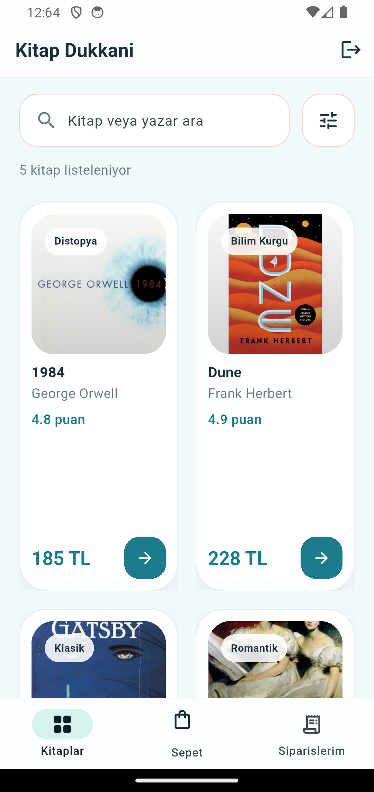

# Book rental app (Kitap Dükkanı)

A Flutter + Firebase book store / rental app with a separate admin view. University coursework / example project; the UI is in Turkish.

> **Status:** Archived. Example project from spring 2026.

<p>
  
  
  
</p>

## Features

- Email/password sign-up and sign-in (Firebase Auth).
- Book catalogue with search, categories, ratings and a detail page (Cloud Firestore; demo books are seeded from `lib/data/demo_books.dart`).
- Cart, checkout and an order history with status tracking: *Onay Bekliyor → Hazırlanıyor → Kargoya Verildi → Teslim Edildi* (pending, preparing, shipped, delivered).
- Admin mode: signing in with the admin account (`kAdminEmail` in `lib/app/app_config.dart`) opens a panel to add books and move orders through the statuses.

## Tech stack

Flutter (Dart), Firebase Auth, Cloud Firestore.

## Run

Firebase config is **not** included: `google-services.json` is not committed and `lib/firebase_options.dart` contains placeholders. Use your own Firebase project:

```bash
cd kitap_kiralama
flutterfire configure      # regenerates lib/firebase_options.dart
flutter pub get
flutter run
```

The project report (Turkish, PDF) is in `kitap_kiralama_raporu.pdf`, with more screenshots in `kitap_kiralama/reports/`.
