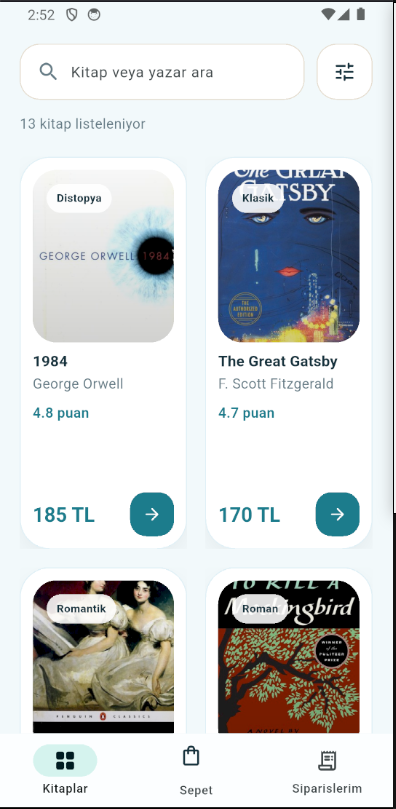
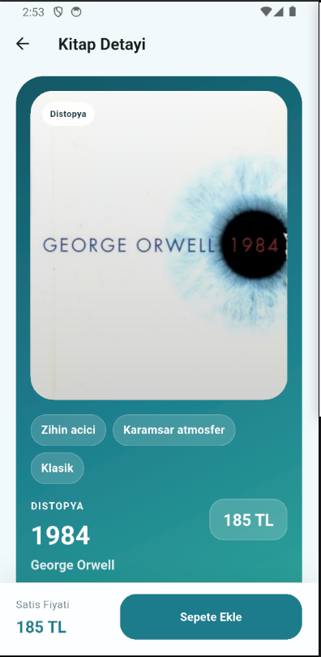
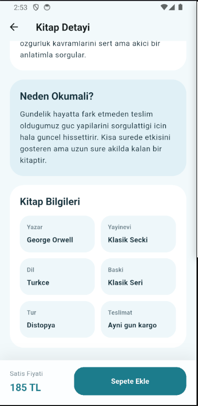
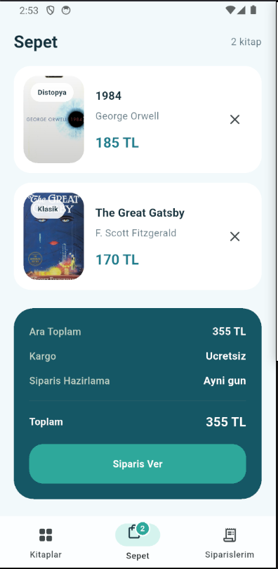
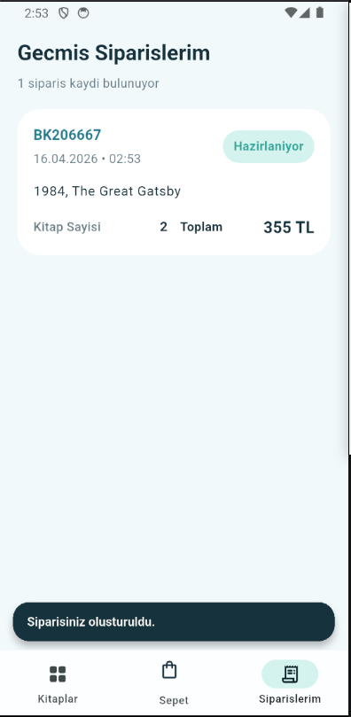
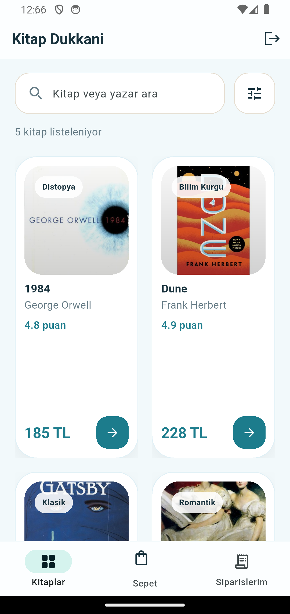
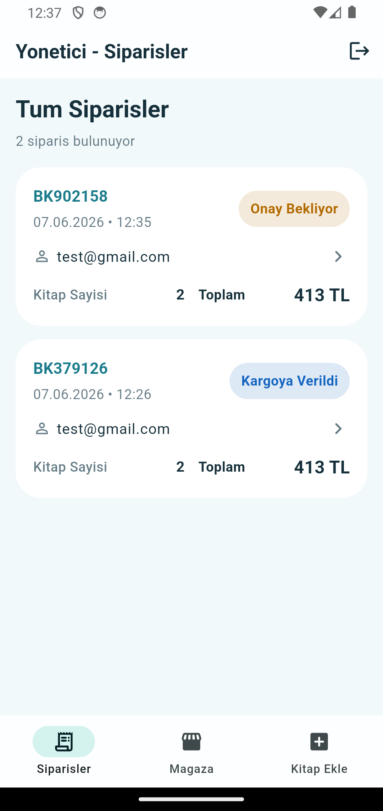
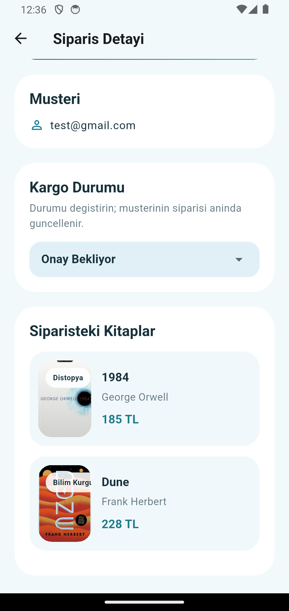
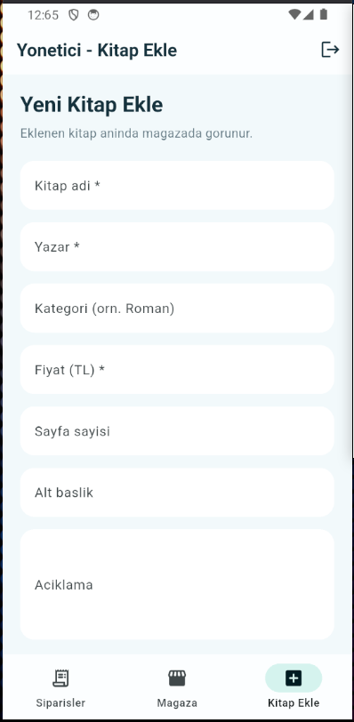
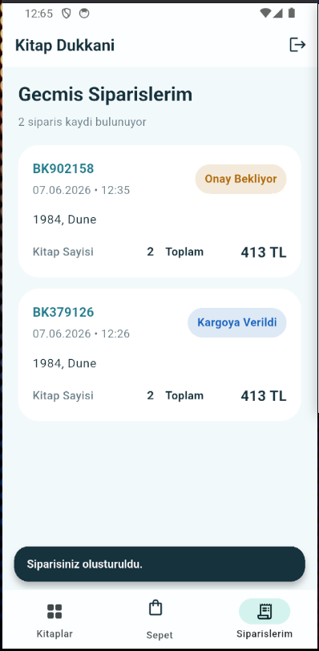

## Icindekiler

1. Projenin Ozeti
2. Projenin Amaci ve Kapsami
3. Genel Uygulama Akisi
4. Proje Dizin Yapisi
5. Projeyi Nasil Ilerlettik
6. Firebase Entegrasyonu ve Veri Katmani
7. Kullanici Hesabi ve Oturum Yonetimi
8. Yonetici (Admin) Paneli ve Siparis Yonetimi
9. Kayitlarin Saklanmasi ve Verinin Korunmasi
10. Kullanici Deneyimi Tarafi
11. Arayuz Tarafi
12. Kod Bolumleri
13. Sonuc ve Genel Degerlendirme
14. Ekran Goruntuleri

## Projenin Ozeti

Bu rapor, Mobil Programlama dersi kapsaminda gelistirdigimiz `kitap_kiralama` projesini anlatmak icin hazirlanmistir. Proje adinda kiralama ifadesi bulunsa da mevcut uygulama akisi kitaplari listeleyen, detayini gosteren, sepete ekleyen ve siparis gecmisini takip ettiren bir mobil arayuz uzerine kurulmustur.

Bu projede amacimiz kitap odakli bir mobil uygulama deneyimini final projesi seviyesinde duzenli, temiz ve sunulabilir bir yapiyla ortaya koymakti. Uygulama kullaniciya once kitap katalogunu sunuyor, ardindan kitap detayina inmesine izin veriyor, daha sonra sepet uzerinden siparis verme akisini tamamlatiyor. Verilen siparisler de ayri bir ekranda tutuluyor ve detayli olarak gorulebiliyor.

Projenin son surumunde uygulama yalnizca bellekte calisan bir prototip olmaktan cikarildi ve Firebase tabanli bir veri katmaniyla desteklendi. Boylece kitap katalogu Cloud Firestore uzerinden cekilmeye, kullanici girisi Firebase Authentication uzerinden yapilmaya, sepet ve siparis kayitlari da her kullaniciya ozel olarak Firestore icinde tutulmaya baslandi. Buna ek olarak yonetici paneli eklendi; admin hesabi tum siparisleri gorup kargo durumunu degistirebiliyor ve yeni kitap ekleyebiliyor.

## Projenin Amaci ve Kapsami

Bu projenin temel amaci sadece bir liste ekrani gostermek degildi. Biz burada daha butunlu bir deneyim kurmak istedik:

1. Kullanici uygulamayi acinca once bir oturum acma ekrani ile karsilassin.
2. Hesabi yoksa hemen ayni ekrandan kayit olabilsin.
3. Giris yaptiktan sonra kitaplari iki sutunlu bir duzende gorebilsin.
4. Arama ve filtreleme ile liste icinde rahat gezebilsin.
5. Bir kitabin detayina girip icerigi, konusu ve temel bilgilerini okuyabilsin.
6. Begendigi kitabi sepete ekleyebilsin ve sepet veritabaninda saklansin.
7. Siparis verince bu kayit Firestore tarafinda kalici olarak tutulsun.
8. Gecmis siparislerden birine tiklayinca o siparisin detaylarini gorebilsin.
9. Admin hesabi ile giris yapildiginda musteri uygulamasi yerine yonetici paneli acilsin.
10. Yonetici tum siparisleri tek ekranda gorup kargo durumunu degistirebilsin.
11. Yonetici yeni kitap ekleyebilsin ve magazayi onizleme modunda gezebilsin.

Bu kapsam icinde proje, ders duzeyinde yeterli olacak kadar islevsel; ama bilincli olarak fazla karmasik olmayan bir noktada tutuldu. Yine de rapor teslim asamasinda kod yapisi daha okunur ve savunulabilir olsun diye dosya yapisi profesyonel sekilde duzenlendi ve gercek bir veri katmani eklendi.

## Genel Uygulama Akisi

Uygulamanin genel akisi su sekilde ilerliyor:

1. Uygulama acildiginda Firebase baslatiliyor ve oturum durumu kontrol ediliyor.
2. Oturum yoksa giris / kayit ekrani aciliyor.
3. Kullanici e-posta ve sifre ile giris yapiyor ya da yeni hesap olusturuyor.
4. Giris yapan e-posta `admin@gmail.com` ise yonetici paneli aciliyor.
5. Normal kullanici girisinde ana ekranda kitap kartlari Firestore'dan cekilip listeleniyor.
6. Ust taraftaki arama alani ile kitap, yazar veya kategori bazli arama yapabiliyor.
7. Filtre butonu ile kategori secimi ve siralama tercihi aciliyor.
8. Kartlardan birine tiklaninca detay sayfasi aciliyor.
9. Detay sayfasinda kitap ozetine, neden okunmasi gerektigine ve kitap bilgilerine ulasilabiliyor.
10. `Sepete Ekle` butonu ile kitap kullanicinin Firestore sepetine kaydediliyor.
11. `Sepet` sekmesinde secilen kitaplar listeleniyor ve toplam tutar gosteriliyor.
12. `Siparis Ver` sonrasi siparis kaydi `users/{uid}/orders` koleksiyonuna `Onay Bekliyor` durumuyla yaziliyor ve sepet temizleniyor.
13. Gecmis siparislerden birine tiklaninca siparis detay sayfasi aciliyor.
14. Admin panelinde tum kullanicilarin siparisleri listeleniyor, siparis detayi acilip durum combobox ile guncelleniyor.
15. Admin panelindeki `Kitap Ekle` sekmesinden `books` koleksiyonuna yeni kitap yazilabiliyor.
16. Sag ust kosedeki cikis butonu ile oturum kapatilabiliyor.

Bu akis teknik olarak buyuk bir e-ticaret sistemi olmasa da final projesi anlatimi icin yeterli bir butunluk sagliyor.

## Proje Dizin Yapisi

Bu asamada proje yapisi daha mantikli klasorlere ayrildi ve Firebase ile ilgili dosyalar eklendi:

```text
kitap_kiralama/
|-- assets/
|   `-- covers/
|-- lib/
|   |-- app/
|   |   |-- admin_app.dart
|   |   |-- app_config.dart
|   |   `-- book_store_app.dart
|   |-- data/
|   |   |-- admin_repository.dart
|   |   |-- demo_books.dart
|   |   |-- books_repository.dart
|   |   `-- user_repository.dart
|   |-- models/
|   |   |-- book.dart
|   |   `-- order_record.dart
|   |-- screens/
|   |   |-- admin_add_book_page.dart
|   |   |-- admin_order_detail_page.dart
|   |   |-- auth_page.dart
|   |   |-- book_detail_page.dart
|   |   |-- cart_tab.dart
|   |   |-- order_detail_page.dart
|   |   |-- orders_tab.dart
|   |   `-- store_home_tab.dart
|   |-- theme/
|   |   |-- app_palette.dart
|   |   `-- app_theme.dart
|   |-- widgets/
|   |   |-- book_card.dart
|   |   |-- book_cover.dart
|   |   |-- cart_icon_badge.dart
|   |   |-- detail_info_tile.dart
|   |   |-- detail_section_card.dart
|   |   |-- detail_stat_card.dart
|   |   |-- highlight_tag.dart
|   |   |-- order_status_pill.dart
|   |   `-- summary_row.dart
|   |-- firebase_options.dart
|   `-- main.dart
|-- firestore.rules
|-- firebase.json
|-- .firebaserc
|-- reports/
|   |-- kitap_kiralama_raporu.md
|   |-- kitap_kiralama_raporu.tex
|   |-- kitap_kiralama_raporu.pdf
|   `-- screenshot_01.png ... screenshot_10.png
`-- pubspec.yaml
```

Buradaki en onemli farklar `lib/firebase_options.dart`, `lib/screens/auth_page.dart`, `lib/data/books_repository.dart`, `lib/data/user_repository.dart`, `lib/data/admin_repository.dart` ve `lib/app/admin_app.dart` dosyalarinin eklenmis olmasidir. Ayni zamanda proje koku artik `firestore.rules`, `firebase.json` ve `.firebaserc` ile birlikte bir Firebase projesi olarak da yapilandirilmistir.

## Projeyi Nasil Ilerlettik

Projeyi gelistirirken asama asama ilerledik. Ilk adimda arayuz kurgusu Figma uzerinde cizildi. Ana ekran, kitap kartlari, detay sayfasi, sepet ve alt menu yapisi once tasarim olarak netlestirildi.

Ikinci adimda bu tasarim Flutter tarafina aktarildi. Yani Figma'da dusundugumuz sayfa duzeni, renk dili ve kart yapisi Flutter widgetlari ile gercek uygulama ekranlarina donusturuldu.

Ucuncu adimda ise kullanicinin gordugu ekranlara islev kazandirildi. Bu kisimda butonlarin calismasi, menu gecisleri, kitap detayina gitme, sepete ekleme, siparis olusturma ve siparis kayitlarini listeleme gibi arka plan mantigi eklendi. Bu noktada veriler henuz yalnizca bellekte tutuluyordu.

Dorduncu adimda projeyi tek dosyali yapidan cikartip `app`, `screens`, `models`, `data`, `theme` ve `widgets` klasorlerine ayirdik. Boylece refactor sonrasi kod tabani daha okunabilir hale geldi.

Besinci adimda Firebase entegrasyonu yapildi. `kitap-kiralama-app` adinda bir Firebase projesi olusturuldu, FlutterFire CLI ile yapilandirma dosyalari uretildi, Firestore veritabani acildi, kitap verileri Firestore'a tasindi, Authentication acilarak e-posta sifre giris destegi eklendi ve sepet ile siparisler kullanici bazli olarak Firestore icinde saklanmaya baslandi.

Son adimda ise yonetici paneli ve siparis durum yonetimi eklendi. `admin@gmail.com` hesabi normal magaza yerine admin paneline yonlendirildi; admin tum siparisleri tek listede gormeye, siparis durumunu degistirmeye, yeni kitap eklemeye ve magazayi onizleme modunda gezmeye basladi.

## Firebase Entegrasyonu ve Veri Katmani

Projenin son asamasinda yalnizca arayuz yeterli olmaz dusuncesiyle bir bulut veri katmani eklenmesine karar verildi. Bu kapsamda asagidaki adimlar yapildi:

1. Firebase CLI uzerinden `kitap-kiralama-app` projesi olusturuldu.
2. Gerekli Google API'leri etkinlestirildi (`firestore.googleapis.com`, `identitytoolkit.googleapis.com`).
3. `(default)` Firestore veritabani `europe-west1` bolgesinde olusturuldu.
4. FlutterFire CLI ile `lib/firebase_options.dart` dosyasi olusturularak Android, iOS ve Web icin yapilandirma uretildi.
5. `firebase_core`, `firebase_auth` ve `cloud_firestore` paketleri `pubspec.yaml` dosyasina eklendi.
6. Kitap verileri seed scripti ile Firestore'da `books` koleksiyonuna yazildi.
7. `firestore.rules` dosyasi ile guvenlik kurallari yazilip Firestore'a deploy edildi.
8. Firebase konsolundan e-posta sifre saglayicisi aktiflestirildi ve `test@gmail.com / 12345678` test hesabi olusturuldu.
9. Admin hesabi icin `admin@gmail.com / admin123` kullanicisi hazirlandi.

Firestore tarafindaki veri modeli su sekildedir:

- `books/{bookId}` koleksiyonu kitap dokumanlarini tutar. Her doküman `id`, `title`, `author`, `category`, `subtitle`, `description`, `rating`, `pages`, `price`, `language`, `publisher`, `readingTime`, `edition`, `coverAsset`, `startColor`, `endColor` alanlarini icerir.
- `users/{uid}/state/cart` dokumani kullanicinin sepetindeki kitaplarin id listesini (`bookIds`) tutar.
- `users/{uid}/orders/{orderCode}` koleksiyonu kullanicinin verdigi siparisleri tutar. Her doküman `orderCode`, `bookIds`, `totalPrice`, `createdAt`, `status`, `userId` ve `userEmail` alanlarindan olusur.

Guvenlik kurallarinda `books` koleksiyonu giris yapmis kullanicilar tarafindan okunabiliyor, yazma yetkisi ise sadece admin hesabina veriliyor. `users/{uid}/**` altinda yer alan dokumanlara sahibi olan kullanici erisebiliyor. Ayrica admin, `collectionGroup('orders')` mantigi ile tum kullanicilarin siparislerini okuyabiliyor ve siparis durumunu guncelleyebiliyor.

## Kullanici Hesabi ve Oturum Yonetimi

Uygulamada oturum yonetimi `FirebaseAuth.instance.authStateChanges()` akisi izlenerek yapiliyor. `main.dart` icindeki `StreamBuilder<User?>` bu akisi dinliyor; oturum yoksa `AuthPage` ekrani, oturum admin hesabina aitse `AdminApp`, diger kullanicilarda ise `BookStoreApp` kabugu render ediliyor.

`AuthPage` ekrani tek bir form uzerinden hem giris hem kayit isini yapacak sekilde tasarlandi:

- Kullanici "Giris Yap" modunda iken `signInWithEmailAndPassword` cagrisi yapiliyor.
- "Kayit Ol" modunda iken `createUserWithEmailAndPassword` cagrisi yapiliyor.
- `FirebaseAuthException` durumlari yakalanip kullanici dostu bir hata mesaji olarak ekranda gosteriliyor.

Test sunumu kolay olsun diye form alanlari acilirken `test@gmail.com` ve `12345678` degerleriyle dolu geliyor. Boylece dersi sunarken hicbir bilgi yazmaya gerek kalmadan tek tikla giris yapilabiliyor.

Uygulama icindeki `AppBar` uzerinde yer alan cikis butonu ise `FirebaseAuth.instance.signOut()` cagrisi ile oturumu kapatiyor. Bu durumda `authStateChanges` akisi `null` doluyor ve uygulama tekrar giris ekranina dusuyor.

## Yonetici (Admin) Paneli ve Siparis Yonetimi

Yonetici ozellikleri sade tutuldu ve ayri bir API katmani yazilmadi. Admin hesabi `admin@gmail.com` olarak belirlendi. `main.dart` icindeki oturum kontrolu artik uc yonlu calisiyor: oturum yoksa giris ekrani, giris yapan kullanici admin ise `AdminApp`, normal kullanici ise `BookStoreApp` aciliyor.

`AdminApp` uc sekmeli bir panel olarak tasarlandi:

- `Siparisler` sekmesi tum kullanicilarin siparislerini tek ekranda gosteriyor.
- `Magaza` sekmesi kitap listesini admin icin onizleme modunda actiriyor.
- `Kitap Ekle` sekmesi yeni kitap bilgilerini alip Firestore `books` koleksiyonuna yaziyor.

Siparis durumu akisi `Onay Bekliyor -> Hazirlaniyor -> Kargoya Verildi -> Teslim Edildi` seklinde belirlendi. Yeni verilen siparisler ilk olarak `Onay Bekliyor` durumu ile kaydediliyor. Admin siparis detayina girdiginde kargo durumunu combobox ile degistirebiliyor. Bu degisiklik dogrudan ilgili kullanicinin `users/{uid}/orders/{orderCode}` dokumanina yazildigi icin musterinin `Siparislerim` ekrani da canli olarak guncelleniyor.

Tum siparisleri okumak icin `AdminRepository.watchAllOrders()` icinde `collectionGroup('orders')` kullanildi. Firestore tarafinda ek indeks zorunlulugu dogmamasi icin bu sorguda `orderBy` kullanilmadi; siparisler uygulama tarafinda `createdAt` degerine gore yeniden eskiye siralandi.

Kitap ekleme akisinda admin kitap adi, yazar, kategori, fiyat, sayfa sayisi, alt baslik ve aciklama gibi alanlari forma giriyor. Form kaydedilince `AdminRepository.addBook()` yeni dokumani `books` koleksiyonuna yaziyor ve kitap listesi tekrar yukleniyor. Bu sayede eklenen kitap magazada hemen gorunuyor.

## Kayitlarin Saklanmasi ve Verinin Korunmasi

Projenin ilk surumlerinde sepet ve siparis verileri sadece bellekte tutuluyordu. Son surumde bu durum tamamen degisti ve veriler Cloud Firestore uzerinden kaliciya alindi.

- Kitap katalogu `books` koleksiyonundan canli olarak cekiliyor. Ders sunumu sirasinda kitap eklemek veya degistirmek istersek tek yapmamiz gereken Firestore tarafini guncellemek.
- Sepet, `users/{uid}/state/cart` dokumaninda tutuluyor. Uygulama her acildiginda bu doküman `snapshots()` ile dinleniyor; baska bir cihazdan giris yapilsa bile sepet senkron kalir.
- Siparisler, `users/{uid}/orders` koleksiyonunda her siparis icin ayri bir doküman olarak tutuluyor. Tarih, toplam tutar, kitap id listesi, durum, kullanici id'si ve kullanici e-postasi burada yer aliyor.
- Firestore guvenlik kurallari sayesinde her kullanici yalnizca kendi verisine erisebiliyor; admin ise sadece gerekli yonetim islemleri icin tum siparisleri okuyup durum guncelleyebiliyor.

Boylece artik uygulama kapansa, telefon yeniden baslatilsa ve hatta baska bir cihazdan giris yapilsa bile sepet ve siparis gecmisi kullanicinin yaninda kaliyor.

## Kullanici Deneyimi Tarafi

Kullanici deneyiminde sade ama bos olmayan bir yapi kurmaya calistik. Bu deneyimin temeli once Figma tarafinda dusunuldu; yani kullanicinin ilk gorecegi yerlesim, arama alani, filtre butonu ve alt gezinme mantigi daha kod yazilmadan once tasarim olarak kurgulandi. Daha sonra Flutter'a aktarilan bu yapi icinde ana ekranda fazla bolum kullanmak yerine kitap listesini merkeze alan daha temiz bir yaklasim korundu. Ust kisimda sadece arama ve filtre butonu birakildi. Bu sayede kullanici ilk bakista ne yapacagini daha rahat anliyor.

Kitap detay ekranlari da sirf bir kapak ve fiyat gosteren yapida birakilmadi. Bunun yerine kitap ozeti, neden okunmasi gerektigi, kitap bilgileri ve etiketler eklenerek detay sayfasi daha dolu ve daha duzgun hale getirildi.

Siparisler tarafi da yalnizca bir liste olarak birakilmadi. Kullanici gecmis siparisine tikladiginda ayri bir detay sayfasi aciliyor ve siparisteki kitaplari tekrar gorebiliyor. Siparis durum etiketi de musteriye siparisinin hangi asamada oldugunu gosteriyor. Admin tarafinda ise tum siparisleri tek ekranda gormek ve durumu combobox ile degistirmek sunum sirasinda uygulamanin tamamlanmis bir is akisi gibi anlatilmasini sagliyor.

## Arayuz Tarafi

Arayuz tarafinda klasik beyaz-mor cizgiden uzaklasmak istedik. Bu nedenle once Figma asamasinda mavi-yesil agirlikli bir tasarim dili dusunduk. Arka plan tamamen koyu degil; acik ama soguk bir ton veriyor. Kartlarda beyaz yuzeyler kullanilirken vurgu butonlari ve durum alanlarinda mavi-yesil gecisler tercih edildi. Daha sonra bu tasarim kararlari Flutter tarafinda korunarak gercek arayuze aktarildi.

Bu son duzenlemede kart yapisi da tekrar ele alindi. `BookCard` bileseni ayri dosyaya tasindi ve ic yerlesimi `Expanded` yapisiyla daha dayanikli hale getirildi. Grid tarafinda sabit iki sutun korunurken kart yuksekligi de buna gore ayarlandi. Boylece kod daha temiz hale gelirken ekran tasmalari da azaltildi.

Yeni eklenen `AuthPage` ekrani da uygulamanin geri kalan renk dilini koruyor. Ust kisimda kitap simgesi, ortada e-posta ve sifre alanlari, alt kisimda ise giris/kayit modu arasinda gecis yapan bir buton bulunuyor. Admin ekranlarinda da ayni sade renk dili korundu; siparis durumu etiketleri onay bekliyor, hazirlaniyor, kargoya verildi ve teslim edildi durumlarina gore farkli renklerle gosteriliyor.

## Kod Bolumleri

Asagida projede rapor acisindan en anlamli gordugumuz dosya ve kod bolumleri yer almaktadir.

### Dosya: `pubspec.yaml`

**Dosyanin gorevi:** Flutter projesinin temel bagimliliklarini ve asset tanimlarini belirlemek.

**Onemli kisim:** Firebase paketleri eklendi.

```yaml
dependencies:
  flutter:
    sdk: flutter
  firebase_core: ^4.2.0
  firebase_auth: ^6.1.0
  cloud_firestore: ^6.4.1

flutter:
  uses-material-design: true
  assets:
    - assets/covers/
```

Bu dosyada artik `firebase_core`, `firebase_auth` ve `cloud_firestore` paketleri yer aliyor. Boylece uygulama Firebase ile haberlesebiliyor.

### Dosya: `lib/firebase_options.dart`

**Dosyanin gorevi:** Android, iOS ve Web icin Firebase yapilandirmasini tek yerden saglamak.

**Satir sayisi:** 74

Bu dosya FlutterFire CLI tarafindan otomatik olarak uretildi. Icinde her platform icin `apiKey`, `appId`, `messagingSenderId`, `projectId` gibi bilgiler tutuluyor. `main.dart` icindeki `Firebase.initializeApp` cagrisi bu dosyayi kullanarak dogru projeyi acmis oluyor.

### Dosya: `lib/app/app_config.dart`

**Dosyanin gorevi:** Admin e-postasi ve siparis durum listesini tek yerde toplamak.

**Satir sayisi:** 13

```dart
const String kAdminEmail = 'admin@gmail.com';

const List<String> kOrderStatuses = <String>[
  'Onay Bekliyor',
  'Hazirlaniyor',
  'Kargoya Verildi',
  'Teslim Edildi',
];
```

Bu dosya sayesinde admin kontrolu ve durum listesi farkli ekranlarda tekrar tekrar yazilmiyor.

### Dosya: `lib/main.dart`

**Dosyanin gorevi:** Firebase baslatma, uygulama tema kurulumu ve oturum durumuna gore giris ekrani / admin paneli / normal uygulama secimi.

**Satir sayisi:** 48

```dart
Future<void> main() async {
  WidgetsFlutterBinding.ensureInitialized();
  await Firebase.initializeApp(options: DefaultFirebaseOptions.currentPlatform);
  runApp(const AppRoot());
}

class AppRoot extends StatelessWidget {
  @override
  Widget build(BuildContext context) {
    return MaterialApp(
      home: StreamBuilder<User?>(
        stream: FirebaseAuth.instance.authStateChanges(),
        builder: (BuildContext context, AsyncSnapshot<User?> snap) {
          final User? user = snap.data;
          if (user == null) {
            return const AuthPage();
          }
          if (user.email == kAdminEmail) {
            return const AdminApp();
          }
          return const BookStoreApp();
        },
      ),
    );
  }
}
```

`main.dart` artik sadece Flutter calistirma gorevini degil, ayni zamanda uc yonlu oturum kontrolunu de yapiyor. Admin hesabi normal kullanici ekranina dusmeden dogrudan yonetici paneline gidiyor.

### Dosya: `lib/screens/auth_page.dart`

**Dosyanin gorevi:** Firebase Authentication uzerinden e-posta sifre ile giris ve kayit isleminin tek bir ekran uzerinden yapilmasini saglamak.

**Satir sayisi:** 160

```dart
Future<void> _submit() async {
  final String email = _emailController.text.trim();
  final String password = _passwordController.text;
  setState(() { _loading = true; _error = null; });
  try {
    if (_isLogin) {
      await FirebaseAuth.instance.signInWithEmailAndPassword(
        email: email, password: password,
      );
    } else {
      await FirebaseAuth.instance.createUserWithEmailAndPassword(
        email: email, password: password,
      );
    }
  } on FirebaseAuthException catch (e) {
    setState(() => _error = e.message ?? e.code);
  } finally {
    if (mounted) setState(() => _loading = false);
  }
}
```

Bu ekran tek bir buton ile hem giris hem kayit yapabiliyor. Form alanlari `test@gmail.com / 12345678` ile onceden dolduruluyor; bu sayede ders sunumu sirasinda hizli giris yapilabiliyor.

### Dosya: `lib/data/books_repository.dart`

**Dosyanin gorevi:** Firestore icindeki `books` koleksiyonundan kitaplari cekip `Book` modeline donusturmek.

**Satir sayisi:** 46

```dart
class BooksRepository {
  final FirebaseFirestore _firestore;

  Future<List<Book>> fetchBooks() async {
    final QuerySnapshot<Map<String, dynamic>> snap =
        await _firestore.collection('books').get();
    return snap.docs.map((d) {
      final m = d.data();
      return Book(
        id: m['id'] as String? ?? d.id,
        title: m['title'] as String? ?? '',
        author: m['author'] as String? ?? '',
        ...
      );
    }).toList();
  }
}
```

Bu dosya artik `demo_books.dart` icindeki sabit listenin yerini aliyor. Uygulama acildiginda kitaplar dogrudan Firestore'dan cekildigi icin kitap eklemek veya degistirmek istedigimizde uygulamaya dokunmaya gerek kalmiyor.

### Dosya: `lib/data/user_repository.dart`

**Dosyanin gorevi:** Giris yapmis kullanicinin sepetini ve siparis gecmisini Firestore uzerinde okumak ve yazmak.

**Satir sayisi:** 82

```dart
DocumentReference<Map<String, dynamic>> get _cartDoc =>
    _firestore.collection('users').doc(_uid).collection('state').doc('cart');

CollectionReference<Map<String, dynamic>> get _ordersCol =>
    _firestore.collection('users').doc(_uid).collection('orders');

Stream<List<String>> watchCartIds() { ... }
Future<void> setCart(List<String> bookIds) async { ... }
Stream<List<OrderRecord>> watchOrders(Map<String, Book> booksById) { ... }
Future<void> placeOrder(OrderRecord order) async { ... }
```

Bu repository sepet icin tek bir doküman, siparisler icin ise her siparis icin ayri bir doküman tutar. `placeOrder()` artik her yeni siparise `Onay Bekliyor` durumunu, kullanici id'sini ve kullanici e-postasini da yazar. `snapshots()` kullandigi icin sepet ve siparisler ekranda canli olarak guncellenir.

### Dosya: `lib/data/admin_repository.dart`

**Dosyanin gorevi:** Admin panelinin tum siparisleri okumasini, siparis durumunu guncellemesini ve yeni kitap eklemesini saglamak.

**Satir sayisi:** 68

```dart
Stream<List<OrderRecord>> watchAllOrders(Map<String, Book> booksById) {
  return _firestore.collectionGroup('orders').snapshots().map((snap) {
    final List<OrderRecord> orders = snap.docs.map((d) {
      final Map<String, dynamic> m = d.data();
      ...
    }).toList();
    orders.sort((a, b) => b.createdAt.compareTo(a.createdAt));
    return orders;
  });
}

Future<void> updateStatus(OrderRecord order, String status) async {
  await _firestore
      .collection('users')
      .doc(order.userId)
      .collection('orders')
      .doc(order.orderCode)
      .update(<String, dynamic>{'status': status});
}

Future<void> addBook(Map<String, dynamic> data) async {
  final String id = data['id'] as String;
  await _firestore.collection('books').doc(id).set(data);
}
```

Burada `collectionGroup('orders')` ile tum kullanicilarin siparisleri tek akista dinleniyor. Siralama Firestore yerine uygulama tarafinda yapildigi icin ek indeks zorunlulugu olusmuyor.

### Dosya: `lib/app/admin_app.dart`

**Dosyanin gorevi:** Admin hesabiyla giris yapildiginda acilan uc sekmeli yonetici panelini kurmak.

**Satir sayisi:** 338

```dart
class AdminApp extends StatefulWidget { ... }

class _AdminAppState extends State<AdminApp> {
  final BooksRepository _booksRepo = BooksRepository();
  final AdminRepository _adminRepo = AdminRepository();

  Future<void> _changeStatus(OrderRecord order, String status) {
    return _adminRepo.updateStatus(order, status);
  }

  Future<void> _addBook(Map<String, dynamic> data) async {
    await _adminRepo.addBook(data);
    await _loadBooks();
  }
}
```

`AdminApp` icinde `Siparisler`, `Magaza` ve `Kitap Ekle` sekmeleri bulunuyor. Magaza sekmesi admin icin onizleme olarak calisiyor; kitap detayinda satin alma cubugu gosterilmiyor.

### Dosya: `lib/screens/admin_order_detail_page.dart`

**Dosyanin gorevi:** Adminin bir siparisin kitaplarini, musteri bilgisini ve kargo durumunu ayrintili gormesini saglamak.

**Satir sayisi:** 287

```dart
DropdownButtonFormField<String>(
  value: _status,
  items: kOrderStatuses
      .map((String status) => DropdownMenuItem<String>(
            value: status,
            child: Text(status),
          ))
      .toList(),
  onChanged: _saving ? null : _onStatusSelected,
)
```

Bu ekranda durum combobox ile degistiriliyor. Degisiklik kaydedilince Firestore'daki siparis dokumani guncelleniyor.

### Dosya: `lib/screens/admin_add_book_page.dart`

**Dosyanin gorevi:** Adminin yeni kitap bilgilerini form uzerinden girip `books` koleksiyonuna eklemesini saglamak.

**Satir sayisi:** 190

```dart
final Map<String, dynamic> data = <String, dynamic>{
  'id': id,
  'title': _title.text.trim(),
  'author': _author.text.trim(),
  'category': _category.text.trim(),
  'price': int.parse(_price.text.trim()),
  ...
};
await widget.onAdd(data);
```

Form kaydedildikten sonra kitap Firestore'a yaziliyor ve magaza listesi yeniden yukleniyor.

### Dosya: `firestore.rules`

**Dosyanin gorevi:** Firestore tarafinda kimlerin neye erisecegini belirlemek.

**Satir sayisi:** 25

```text
rules_version = '2';
service cloud.firestore {
  match /databases/{database}/documents {
    function isAdmin() {
      return request.auth != null
        && request.auth.token.email == 'admin@gmail.com';
    }

    match /books/{bookId} {
      allow read: if request.auth != null;
      allow write: if isAdmin();
    }

    match /users/{userId}/{document=**} {
      allow read, write: if request.auth != null && request.auth.uid == userId;
    }

    match /{path=**}/orders/{orderId} {
      allow read: if isAdmin();
      allow update: if isAdmin();
    }
  }
}
```

Bu kurallar sayesinde kitap katalogu giris yapmis kullanicilar tarafindan okunabiliyor, kitap yazma yetkisi admin ile sinirli kaliyor. Kullanici verileri sahibine acik; admin ise tum siparisleri okuyup sadece durum guncellemesi yapabiliyor.

### Dosya: `lib/app/book_store_app.dart`

**Dosyanin gorevi:** Uygulamanin ana sekmelerini, kitap yuklemesini, sepet/siparis akisini ve cikis butonunu yonetmek.

**Satir sayisi:** 229

```dart
class _BookStoreAppState extends State<BookStoreApp> {
  final BooksRepository _booksRepo = BooksRepository();
  final UserRepository _userRepo = UserRepository();

  List<Book> _books = <Book>[];
  List<Book> _cart = <Book>[];
  List<OrderRecord> _orders = <OrderRecord>[];

  Future<void> _bootstrap() async {
    final books = await _booksRepo.fetchBooks();
    final byId = { for (final b in books) b.id: b };
    setState(() { _books = books; _booksById = byId; });

    _cartSub = _userRepo.watchCartIds().listen((ids) {
      setState(() => _cart = [for (final id in ids) if (byId[id] != null) byId[id]!]);
    });
    _ordersSub = _userRepo.watchOrders(byId).listen((orders) {
      setState(() => _orders = orders);
    });
  }

  Future<bool> _addToCart(Book book) async {
    if (_isInCart(book)) return false;
    final next = [..._cart.map((b) => b.id), book.id];
    await _userRepo.setCart(next);
    return true;
  }

  Future<void> _completeOrder(OrderRecord order) async {
    await _userRepo.placeOrder(order);
    setState(() => _selectedIndex = 2);
  }
}
```

Bu kabuk artik kitaplari Firestore'dan cekiyor, sepet ve siparisleri repository uzerinden okuyup yaziyor. `AppBar` icine eklenen cikis butonu ile `FirebaseAuth.instance.signOut()` cagriliyor.

### Dosya: `lib/screens/cart_tab.dart`

**Dosyanin gorevi:** Sepetteki urunleri listelemek, toplam tutari hesaplamak ve siparisi olusturmak.

```dart
final OrderRecord order = OrderRecord(
  orderCode: orderCode,
  items: List<Book>.from(cartItems),
  totalPrice: totalPrice,
  createdAt: DateTime.now(),
);

onPlaceOrder(order); // BookStoreApp icinde Firestore'a yaziliyor
```

Eskiden `onPlaceOrder` yalnizca bellege ekleme yapiyordu. Yeni surumde ise bu cagri `UserRepository.placeOrder` uzerinden Firestore'a kayit atiyor, ardindan sepet temizleniyor.

### Dosya: `lib/models/order_record.dart`

**Dosyanin gorevi:** Siparis bilgisini ekranlar ve repository'ler arasinda tasimak.

**Satir sayisi:** 51

```dart
class OrderRecord {
  const OrderRecord({
    required this.orderCode,
    required this.items,
    required this.totalPrice,
    required this.createdAt,
    this.status = 'Onay Bekliyor',
    this.userId = '',
    this.userEmail = '',
  });

  String get statusLabel => status;
}
```

Model artik siparis durumunu, kullanici id'sini ve kullanici e-postasini da tutuyor. Bu alanlar admin panelinde siparisi dogru kullaniciyle eslestirmek icin kullaniliyor.

## Sonuc ve Genel Degerlendirme

Bu projede hedefimiz asiri buyuk bir mimari kurmak degildi. Bunun yerine final projesi seviyesinde derli toplu, duzgun gorunen ve adim adim anlatilabilecek bir kitap uygulamasi olusturduk. Geldigimiz noktada uygulama:

- e-posta sifre ile giris ve kayit yapiyor,
- kitaplari Firestore uzerinden listeliyor,
- arama ve filtreleme yapiyor,
- detay sayfasi aciyor,
- sepete ekliyor ve sepeti Firestore'da saklayip canli senkronize ediyor,
- siparis verdiriyor ve siparisleri kullanici bazli kaydediyor,
- siparisleri ayri ekranda tutuyor,
- yonetici hesabiyla tum siparisleri tek ekranda yonetiyor,
- kargo durumunu onay bekliyor, hazirlaniyor, kargoya verildi ve teslim edildi adimlari arasinda degistirebiliyor,
- yeni kitap ekleyebiliyor,
- admin magazayi satin alma cubugu olmadan onizleyebiliyor,
- guvenlik kurallari sayesinde kullanici verisini sadece sahibine, yonetim islemlerini de admin hesabina aciyor.

Bu son duzenleme ile birlikte proje yalnizca islevsel degil, kod yapisi ve veri katmani acisindan da daha savunulabilir hale geldi. `main.dart` sade bir giris noktasina indirildi; ana akis, admin paneli, ekranlar, modeller, repository'ler, ortak widgetlar ve Firebase yapilandirmasi kendi dosyalarina ayrildi. Bu haliyle proje, hem arayuz hem temel akis hem kod organizasyonu hem de bulut veri katmani acisindan tamamlanmis bir final odevi niteligindedir.

## Ekran Goruntuleri

Asagidaki gorseller uygulamanin farkli ekranlarindan alinmistir.




















